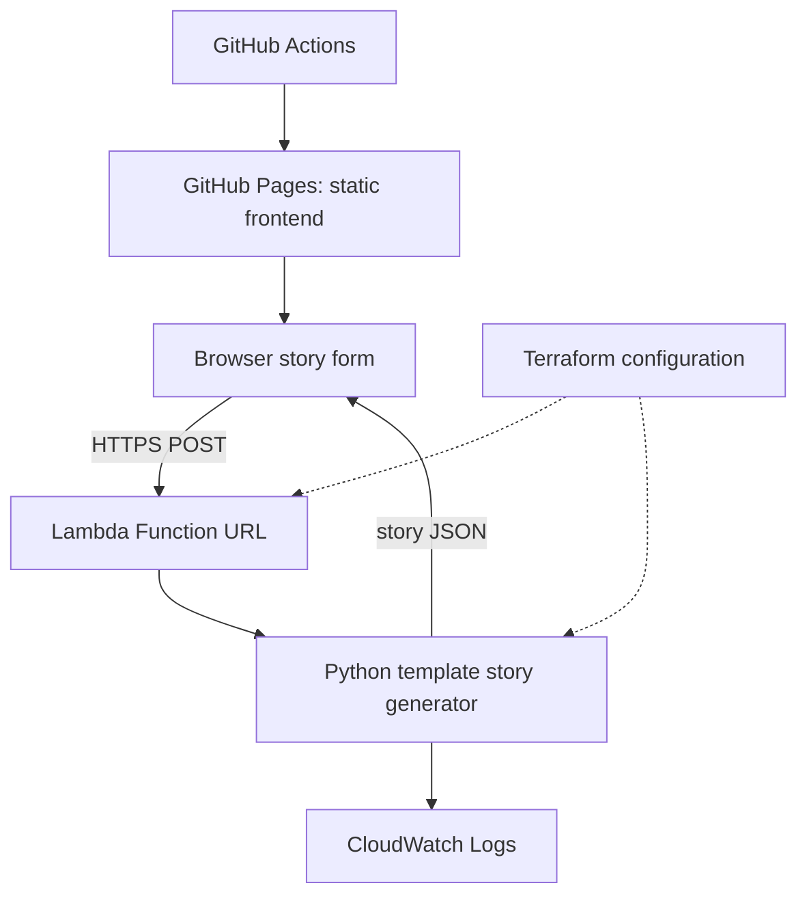

# Bousbi's Tiny Tale Machine

A small serverless bedtime-story app. A browser form sends a child's name, animal, place and mood to a Python Lambda, which assembles a story from predefined text fragments.

**Status:** The current implementation uses templates, with no AI model or database. The checked-in hosting workflow deploys the frontend to GitHub Pages from main.

## Architecture

## Start here

The frontend lives in [frontend/](frontend/) and the handler in [lambda/lambda_function.py](lambda/lambda_function.py). Run `python3 -m unittest discover -s lambda -v` for the included handler tests. Configure the Lambda URL and allowed frontend origin before using the app. Terraform provisions the backend; no S3/CloudFront hosting stack is present on this branch.

[Previous README and detailed reference](https://github.com/mtzanida/bousbis-tiny-tale-machine/blob/7fc69a17d213c9bba7afc2c6b9e178f7ba8d861d/README.md) are retained in Git history. They may describe older assumptions or unmerged plans; the scope above reflects this branch.

License: [MIT](LICENSE).
